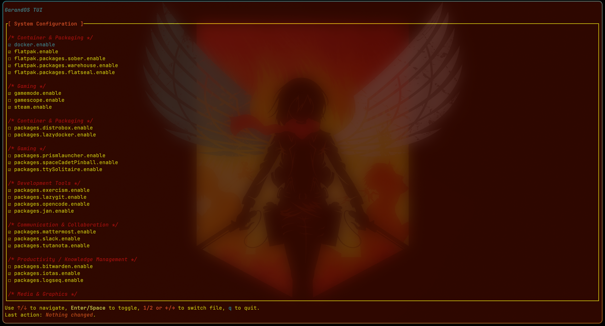

# GarandOS TUI

## Overview

GarandOS TUI is a terminal-based user interface tool designed to simplify the management of enabled modules in GarandOS NixOS configurations. It allows users to easily view and toggle boolean configuration options in both system and home module files through an intuitive interface.



## Features

- Dual-pane interface for managing both system and home modules
- Categorized view of configuration options
- Simple keyboard navigation
- Real-time toggle of boolean values in Nix configuration files
- Automatic parsing and writing of Nix configuration syntax
- Available via flake.nix

## Installation

### Using Nix

#### As a Standalone Package

```bash
# Clone the repository
git clone https://gitea.garandplg.com/GarandPLG/garandos-tui.git
cd garandos-tui

# Build using Nix
nix build

# Run the application
nix run
```

### Building from Source

```bash
# Clone the repository
git clone https://gitea.garandplg.com/GarandPLG/garandos-tui.git
cd garandos-tui

# Build with Cargo
cargo build --release

# Run the application
cargo run -- --sf /path/to/system-modules.nix --hf /path/to/home-modules.nix
```

## Usage

```bash
garandos-tui --help

garandos-tui --sf /path/to/system-modules.nix --hf /path/to/home-modules.nix
```

Where:
- `--sf` specifies the path to your system modules file
- `--hf` specifies the path to your home modules file

In GarandOS, these files are located in:
```
~/garandos/hosts/<hostname>/system-modules.nix
~/garandos/hosts/<hostname>/home-modules.nix
```

## Controls

| Key                | Action                         |
|--------------------|--------------------------------|
| `↑` / `↓`          | Navigate options               |
| `Enter` / `Space`  | Toggle selected option         |
| `1` / `←`          | Switch to System modules       |
| `2` / `→`          | Switch to Home modules         |
| `q`                | Quit application               |

## Interface

The GarandOS TUI interface is divided into three main sections:

1. **Header** - Shows the application title
2. **Content Area** - Displays the configuration options, organized by categories
3. **Footer** - Shows key bindings and the last action performed

Options are displayed with checkboxes:
- `☐` - Option is disabled (false)
- `☑` - Option is enabled (true)

## Configuration Format

GarandOS TUI works with Nix configuration files that use a specific structure of boolean options. Options are organized by category using comments, for example:

```nix
_: {
  /*
  Container & Packaging
  */
  docker.enable = true; # Docker: container runtime and management
  flatpak = {
    enable = true; # Flatpak: universal packaging system for Linux
    packages = {
      sober.enable = false; # Roblox client
      warehouse.enable = true; # Flatpak manager
      flatseal.enable = true; # Flatpak permissions manager
    };
  };

  /*
  Gaming
  */
  gamemode.enable = true; # GameMode: optimizes system performance for gaming
  gamescope.enable = false; # Gamescope: micro‑compositor for games
  steam.enable = true; # Steam: platform for buying and playing games
}
```

## NixOS Module Configuration

When using GarandOS TUI as a NixOS module, the following options are available:

| Option                | Description                                  | Default               |
|-----------------------|----------------------------------------------|----------------------|
| `enable`              | Enable the GarandOS TUI module               | `false`              |
| `package`             | The GarandOS TUI package to use              | Default package      |
| `systemModulesFilePath` | Path to system modules file                | `""`                 |
| `homeModulesFilePath` | Path to home modules file                    | `""`                 |

## Development

### Development Environment

A development shell is provided via Nix:

```bash
# Enter development shell
nix develop

# Available commands in the shell:
# - nix build            - Build production version
# - nix run              - Run production version
# - nix build .#develop  - Build development version
# - nix run .#develop    - Run development version
```

### Project Structure

- `src/`
  - `main.rs` - Application entry point
  - `app.rs` - TUI application logic
  - `cli.rs` - Command-line interface
  - `nix.rs` - Nix file parsing and manipulation
  - `lib.rs` - Module exports

## License

GarandOS TUI is licensed under the MIT License. See the [LICENSE](./LICENCE) file for details.

## Authors

- GarandPLG - [Gitea](https://gitea.garandplg.com/GarandPLG)

## Acknowledgments

- [ratatui](https://github.com/ratatui-org/ratatui) - Terminal UI library
- [rnix](https://github.com/nix-community/rnix-parser) - Nix parser library
- [clap](https://github.com/clap-rs/clap) - Command-line argument parser
- [crossterm](https://github.com/crossterm-rs/crossterm) - Terminal manipulation library
